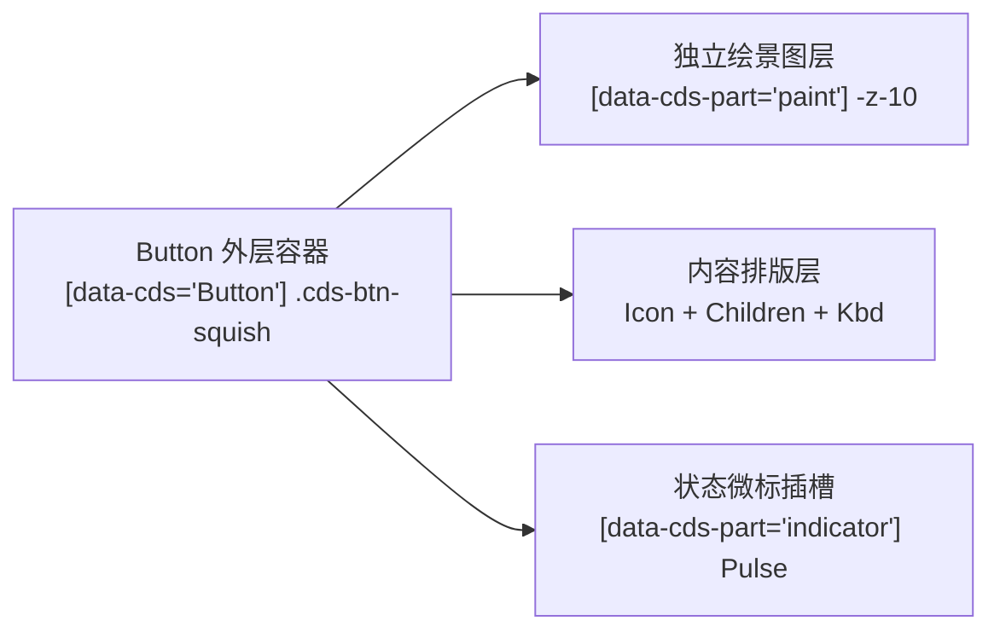

<p align="center">
  [⬅️ 上一篇：第一篇：设计哲学与设计令牌体系](01-设计哲学与设计令牌体系.md) · [📚 返回总目录](Claude%20Design%20System%20(CDS).md) · [下一篇：第三篇：会话核心流与指令交互引擎 ➡️](03-会话核心流与指令交互引擎.md)
</p>

---

## 第二篇：基础原子组件与交互控件

> **技术领域与英文指代**：`Foundational Atoms & Controls`

依托 **REA (Reverse Engineer Anything) v6.5.0** 对官方最新版 Claude Desktop (`/Applications/Claude.app`，`@ant/desktop v2.37337.1`，ASAR 证据 `ev_e0bd89cee50a5b7d0dbf9e75cef5dfbca2bcb1699df4d4371449dd08452a8358`) 的逆向取证，本篇系统性拆解 Claude 基础交互控件的生产级 DOM 结构、CSS 实用类组合与原生物理微交互算法。

---

### 2.1 全能按钮控件阶梯

> **技术领域与英文指代**：`Buttons & Controls - CdsButton / [data-cds="Button"]`

#### 2.1.1 控件高度标尺与排版尺寸矩阵

依据 REA 对 `shared-frame-BfjMqbuN.js` 与 `c6a992d55-sXiDGMFQ.css` 的逆向提取，Claude 绝非使用粗放的 4 级尺寸，而是构建了严苛的 **5 阶高度标尺**，并通过桌面端光学缩放因子 `--cds-rem-scale: calc(16 / 17)`（≈ 0.941176）进行亚像素对齐：

| 尺寸代号 | CSS 表达式 (Rem Scale) | 桌面端实际像素 | 内边距 (`padding`) | 圆角 (`radius`) | 字体与排版角色 |
| :--- | :--- | :--- | :--- | :--- | :--- |
| **`xxs`** (`data-step="1"`) | `calc(1.25rem * scale)` | **18.82px (约 19px)** | `px-1.5 py-0` | `--radius-sm` (4px) | `11px` Caption，极紧凑行内重试、次级小动作 |
| **`xs`** | `calc(1.5rem * scale)` | **22.59px (约 23px / 24px)**| `px-2 py-0.5` | `--radius-md` (6px) | `11.5px` Footnote，标签删除、代码块辅助栏 |
| **`sm`** | `calc(1.75rem * scale)` | **26.35px (约 26px / 28px)**| `px-2.5 py-1` | `--radius-lg` (8px) | `12.5px`，下拉菜单项、输入框内操作胶囊 |
| **`md` (官方默认)** | `calc(2rem * scale)` | **30.12px (约 32px)** | `px-3.5 py-1.5` | `--radius-lg` (8px) | `13.5px` Body，**标准交互动作、表单确认** |
| **`lg`** | `calc(2.5rem * scale)` | **37.65px (约 40px)** | `px-5 py-2` | `--radius-xl` (12px) | `15px` Heading，全局首要引导、登录主操作 |
| **`icon`** (纯图标) | 固定正方形宽高比 | `aspect-square w-control` | `p-0` | `--radius-lg` (8px) | 工具栏独立图标操作（如关闭、复制、更多） |

> [!NOTE]
> **嵌套控件高度衰减公式 (`--cds-h-control-nested`)**：  
> 当按钮被嵌套在 Composer 或工具栏容器中时，Claude 自动切换为嵌套高度变量：  
> `nested-xs: calc(1.125rem * scale)` (17px) / `nested-sm: calc(1.25rem * scale)` (18.8px) / `nested-default: calc(1.375rem * scale)` (20.7px) / `nested-lg: calc(1.75rem * scale)` (26.35px)。

---

#### 2.1.2 生产级 6 大核心变体契约 (Variants Architecture)

REA 逆向揭示，Claude 的按钮组件由两层结构正交构成：**外层交互重置壳** + **内层独立绘景层 (`data-cds-part="paint"`)**。这一架构彻底解耦了外轮廓焦点环、内阴影与背景渐变，杜绝了传统 CSS 按钮在 Hover/Active 时内外尺寸微抖的缺陷。



```javascript
/* 提取自官方生产包 shared-frame-BfjMqbuN.js 原生变体映射 */
const Il = "cds-reset group/btn relative isolate inline-flex shrink-0 items-center justify-center gap-1.5 whitespace-nowrap select-none cursor-[var(--cds-cursor-interactive)] aria-disabled:cursor-default data-[disabled]:cursor-default border-0 outline-none focus-visible:outline-hidden rounded h-control font-sans text-body transition-shadow duration-fast";
```

| 变体代号 | 视觉语义角色 | 文字排版与前景色 | 绘景图层样式 (`data-cds-part="paint"`) | 交互状态与物理特征 |
| :--- | :--- | :--- | :--- | :--- |
| **`secondary`**<br>(**Claude 官方默认**) | 卡片内次级操作，**绝不带硬边框**，严格遵循单闭合边框原则 | `text-primary font-normal font-control aria-pressed:text-accent` | `bg-fill-secondary group-hover/btn:bg-fill-secondary-hover dark:bg-white/10 dark:hover:bg-white/15` | `shadow-field group-aria-pressed/btn:shadow-field-pressed` |
| **`primary`** | 关键正向提交、发送提示词 | `text-on-primary font-medium font-control` | `bg-fill-primary group-hover/btn:bg-fill-primary-hover` (陶土实色) | `shadow-2xs active:brightness-95` |
| **`ghost`** | 工具栏图标、内联微操作、次级折叠条 | `text-primary font-normal font-control aria-pressed:text-accent` | `bg-transparent group-hover/btn:bg-fill-ghost-hover` | 悬停渐入 5% 灰度，激活 `bg-fill-ghost-selected` |
| **`danger`** | 模态确认删除、清空项目等毁灭性动作 | `text-on-danger font-medium font-control` | `bg-fill-danger group-hover/btn:bg-fill-danger-hover` (警示深红) | `focus-visible:shadow-focus-danger` 专用红光晕 |
| **`brand`** | 桌面端官方品牌高亮操作 | `text-on-brand font-medium font-control` | `bg-fill-brand group-hover/btn:bg-fill-brand-hover` (`--brand: #c6613f`) | 官方深陶土桌面品牌色 |
| **`onContent`** | 浮动于复杂代码、图片或全屏视频上方的覆层操作 | `text-primary font-medium font-control` | `bg-[var(--cds-button-on-content)] backdrop-blur-md shadow-[inset_0_0_0_1px_var(--cds-button-on-content-ring)]` | 4px 毛玻璃羽化，深色半透明抗背景干扰 |

---

#### 2.1.3 按钮动态阻尼物理学与 15 阶纯 CSS 弹簧 (`.cds-btn-squish`)

REA 对 `c6a992d55-sXiDGMFQ.css` 进行逆向取证时，发现了 Claude 极其惊艳的**真实物理弹簧形变系统**：它绝非传统前端写死的硬性 `scale(0.98)`，而是结合运行时按钮高度自适应计算阻尼系数，并在松开瞬间触发 **15 阶 CSS `linear()` 弹簧曲线**：

```css
/* 提取自 c6a992d55-sXiDGMFQ.css 真实生产定义 */
:root {
  --cds-btn-spring: linear(
    0, .2459, .6526, .9468, 1.0764, 1.0915, 1.0585, 1.0219, 
    .9993, .9914, .9921, .9957, .9988, 1.0004, 1
  );
}

.cds-btn-squish {
  --cds-btn-press-sx: 0.975;
  --cds-btn-press-sy: 0.975;
  transform-origin: 50%;
  transition: transform var(--cds-dur-slow) var(--cds-btn-spring);
}

.cds-btn-squish:active, :active > .cds-btn-squish {
  transform: scale(var(--cds-btn-press-sx), var(--cds-btn-press-sy));
  transition: transform var(--cds-dur-fast) ease-out;
}
```

> [!TIP]
> **弹簧数学分析 (Spring Physics Analysis)**：  
> 在 `--cds-btn-spring` 曲线中，按压释放瞬间先在 40% 时间点冲出至 `1.0915`（**+9.15% 物理过冲**），随后微回弹至 `0.9914`，并在 `1.0004` 处精准阻尼收敛。配合 JS 动态微调：  
> `Bl(h) = Math.min(1.5, Math.max(0.5, h * (1 / 32)))`，保证小按钮微缩放细腻，大按钮扎实回弹。

---

#### 2.1.4 组合按钮组协议 (Joined Buttons)

当多个按钮以组合条形态并排出现时（如分段视图切换、撤销/重做组），外层注入 `joined` 拓扑控制，自动剔除内侧圆角并消除双重中缝边框：
* **首项 (`start`)**：`rounded-e-none`（右侧直角）
* **中间项 (`middle`)**：`rounded-none`（两侧直角）
* **末项 (`end`)**：`rounded-s-none`（左侧直角）

> **生产级独立组件实现**：[`code-examples/CdsButton.tsx`](../code-examples/CdsButton.tsx)（已全量同步 5 阶尺寸、6 大变体、绘景层分离与 `.cds-btn-squish` 15 阶弹簧物理算法）。

---

### 2.2 分段滑动选择胶囊

> **技术领域与英文指代**：`Segmented Control & Pills - .df-pills[data-segmented]`

Claude 桌面端顶部导航与设置中的滑动 Tab 采用 **999px 全圆角轨道 + 纯几何等分滑块 + 双断点容器查询自适应折叠** 架构。

#### 2.2.1 轨道与滑动指示器精确几何参数

```css
/* 提取自 shared-styles-Bl9zqrv-.css 与 frame-window-BEI3vR8Q.css */
.df-pills[data-segmented] {
  padding: 1px; /* 严格 1px 环绕间距，杜绝 2px 的笨拙感 */
  container-type: inline-size;
  border-radius: 999px;
  background: var(--cds-segmented-control-track, rgba(0, 0, 0, 0.06));
}

.df-pills[data-segmented] .df-pill-indicator {
  position: absolute;
  top: 1px;
  bottom: 1px;
  border-radius: calc(var(--cds-radius) - 1px);
  will-change: transform;
  transition: transform var(--cds-dur-snap) var(--cds-ease-snap), 
              background-color var(--df-dur-slow) var(--df-ease-out);
}
```

* **纯几何等分比例公式 (Pure Geometric Allocation)**：
  滑块水平位置与宽度严丝合缝匹配轨道内 1px 间隙：
  ```css
  left: calc(1px + var(--active-index) * (100% - 2px) / var(--total-tabs));
  width: calc((100% - 2px) / var(--total-tabs));
  ```
* **光学双层弥散投影 (Dual-Layer Optical Shadow)**：
  - **浅色模式**：
    `background: var(--cds-neutral-20); box-shadow: inset 0 0 0 0.5px var(--cds-border), 0 1px 2px #0000000f, 0 2px 6px -1px #0000000d;`
  - **深色模式**：
    `background: var(--cds-segmented-control-thumb); box-shadow: inset 0 0 0 0.5px #ffffff14, 0 1px 2px #0000004d, 0 2px 6px -1px #00000040;`

---

#### 2.2.2 双断点容器查询自适应折叠协议 (@container)

当容器宽度被窄侧边栏或窗口拉伸挤压时，Claude 绝不生硬换行，而是依托 `@container` 逐级收缩未激活项标签：

```css
/* 提取自 c6a992d55-sXiDGMFQ.css 真实生产容器断点 */

/* 1. 两项分段控制器：容器宽度 <= 180px 时折叠 */
@container (width <= 180px) {
  .df-pills[data-segmented][data-pills="2"] .df-pill:not([data-active]) .df-pill-label {
    display: none;
  }
  .df-pills[data-segmented][data-pills="2"] .df-pill:not([data-active]) {
    padding: 0;
  }
  .df-pills[data-segmented][data-pills="2"] .df-pill[data-active] {
    flex: none;
    padding: 0 16px;
  }
}

/* 2. 三项分段控制器：容器宽度 <= 254px 时折叠 */
@container (width <= 254px) {
  .df-pills[data-segmented][data-pills="3"] .df-pill:not([data-active]) .df-pill-label {
    display: none;
  }
  .df-pills[data-segmented][data-pills="3"] .df-pill:not([data-active]) {
    padding: 0;
  }
  .df-pills[data-segmented][data-pills="3"] .df-pill[data-active] {
    flex: none;
    padding: 0 16px;
  }
}
```

> **生产级独立组件实现**：[`code-examples/SegmentedControl.tsx`](../code-examples/SegmentedControl.tsx)（支持 1px 严苛轨道定位、双断点容器自适应折叠与 Framer Motion 物理弹簧双模式）。

---

### 2.3 状态指示灯与微动效套件

> **技术领域与英文指代**：`Status Indicators & Shimmer`

在 Claude 界面中，微型指示灯与扫光条承担着系统实时状态（运行中、思考中、空闲、就绪）的关键传达职责：

#### 2.3.1 官方标准 6px 状态指示灯矩阵 (`.status-dot`)

REA 逆向从 `shared-styles-Bl9zqrv-.css` 中提取到的官方状态灯基准类为 `.status-dot`（**严格 6px 直径圆形**）：

```css
.status-dot {
  width: 6px;
  height: 6px;
  border-radius: 50%;
  display: block;
  position: relative;
}
```

| 状态代号 | 视觉颜色 | 动画时序与关键帧 | 业务承载场景 |
| :--- | :--- | :--- | :--- |
| **`ready`** | `var(--cds-fill-accent)` | 静态常亮，无额外消耗 | 桌面端就绪、会话同步完成、模型待命 |
| **`running`** | `var(--cds-fill-accent)` | `1.2s ease-in-out infinite dframe-dot-blink` (透明度 0.3 $\leftrightarrow$ 1.0) | 后台活动通信中、工件代码构建中 |
| **`error`** | `var(--cds-fill-danger)` | 静态深红高亮 | 连接超时、MCP 工具执行失败 |
| **`clay`** | `var(--cds-clay)` | **`3.0s ease-in-out infinite dframe-clay-breathe`** | Extended Thinking 深度推理与模型核心算力脉冲 |

```css
/* 陶土呼吸关键帧提取自 shared-styles-Bl9zqrv-.css */
@keyframes dframe-clay-breathe {
  0%, 100% { filter: brightness(0.96); transform: scale(0.86); }
  50%      { filter: brightness(1.06); transform: scale(1); }
}
```

---

#### 2.3.2 思考波浪三点跳跃规范 (`.timeline-quiet-dots`)

在思考链或消息输出等待态，Claude 渲染专有的 3 点波浪脉冲：
* **容器几何**：`gap: 3.5px; display: inline-flex; position: relative; top: 0.26em;`
* **单点几何**：`width: 3px; height: 3px; border-radius: 50%; background: var(--cds-clay, #d97757);`
* **三阶延迟与运动轨迹**：
  - 周期：**`1.9s cubic-bezier(0.4, 0, 0.2, 1) infinite`**
  - 阶梯相位差：点 1 为 `0s`，点 2 为 `0.15s`，点 3 为 `0.3s`
  - 运动关键帧：
    ```css
    @keyframes timeline-quiet-dot {
      0%, 8%   { opacity: 0; transform: translateY(2px); }
      22%      { opacity: 1; transform: translateY(-2.5px); }
      36%, 70% { opacity: 1; transform: translateY(0); }
      90%, 100%{ opacity: 0; transform: translateY(0); }
    }
    ```

---

#### 2.3.3 骨架屏 105° 倾角平移扫光 (`cds-skeleton-sweep`)

在卡片、正文骨架加载阶段，Claude 采用极具质感的非对称角度扫光：
* **周期与缓动**：`animation: cds-skeleton-sweep 2s linear infinite;`（严格 2.0s 匀速，非 1.6s）。
* **光带倾角**：
  - LTR 模式：`linear-gradient(105deg, transparent 35%, var(--cds-skeleton-sheen) 50%, transparent 65%)`
  - RTL 镜像模式：`linear-gradient(255deg, transparent 35%, var(--cds-skeleton-sheen) 50%, transparent 65%)`
* **关键帧**：
  ```css
  @keyframes cds-skeleton-sweep {
    0%   { transform: translate(-100%); }
    100% { transform: translate(100%); }
  }
  ```

> **生产级独立组件实现**：[`code-examples/StatusIndicators.tsx`](../code-examples/StatusIndicators.tsx)。

---

### 2.4 模态确认对话框

> **技术领域与英文指代**：`Confirmation Dialog - [data-cds="Dialog"]`

在执行清空会话、删除项目、重置密钥或高风险 MCP 工具调用时呼出的模态确认对话框：

#### 2.4.1 6 阶弹窗标尺与视口安全上限

依据 REA 对 `shared-frame-BfjMqbuN.js` 生产 Dialog 控制器的提取，Claude 构建了系统级 6 阶弹窗矩阵：

```javascript
/* 提取自官方生产包 shared-frame-BfjMqbuN.js 原生 Qg 尺寸表 */
const Qg = {
  sm: "max-w-[400px]",       // 极简确认、单项授权
  md: "max-w-[520px]",       // 标准确认模态框（默认）
  lg: "max-w-[720px]",       // 复杂表单、环境配置
  xl: "max-w-[880px]",       // 代码对比确认
  "2xl": "max-w-[1024px]",   // 宽屏工件预览
  "3xl": "max-w-[1152px]"    // 全功能工作区看板
};
```

* **视口高度自适应截断安全公式 (`--environment-dialog-cap`)**：
  ```css
  --environment-dialog-cap: calc(
    100dvh - max(2rem, 2 * var(--desktop-titlebar-inset, 0px)) 
    - 2 * max(env(safe-area-inset-top, 0px), env(safe-area-inset-bottom, 0px))
  );
  ```
  保证弹窗在所有桌面端（macOS 信号灯刘海屏、Windows 标题栏）下均不溢出视口。

---

#### 2.4.2 嵌套弹窗防御体系 (Nested Dialog Blurring Protocol)

当模态对话框内部再次唤起二级子弹窗时（如在确认弹窗中点击“查看详情”弹窗），Claude 通过属性选择器自动对底层父弹窗进行物理虚化与暗化拦截：

```javascript
/* 提取自 shared-frame-BfjMqbuN.js */
const Xg = "after:pointer-events-none after:absolute after:inset-0 after:rounded-[inherit] after:bg-backdrop after:opacity-0 after:z-50 after:transition-opacity after:duration-base after:ease-out data-[nested-dialog-open]:after:opacity-100";
const Zg = "data-[nested-dialog-open]:blur-[2px]";
```

当父弹窗检测到 `data-[nested-dialog-open]` 时：
1. 立即触发 `blur-[2px]`，消除文字高频细节；
2. 伪元素 `after` 透明度从 0 平滑过渡至 100%，覆盖一层半透明微遮罩；
3. 视线焦点绝对聚焦于最新呼出的二级模态框。

---

#### 2.4.3 原生滚动时间轴与双环弥散投影

* **双环 Popover 投影 (`--cds-shadow-popover`)**：
  外层高斯模糊与内层倒角物理顶光反光，外轮廓不带任何 1px 生硬黑线。
* **滚动时间轴驱动**：
  容器内置 `[scroll-timeline:--cds-dialog-scroll_block]` 与 `.scroll-fade-y`，内容超长产生纵向滚动时，自动触发 Chapter 1 提取的 28px 相对色彩渐隐遮罩。

> **生产级独立组件实现**：[`code-examples/ConfirmationDialog.tsx`](../code-examples/ConfirmationDialog.tsx)。

---

### 2.5 附件磁贴与上下文胶囊

> **技术领域与英文指代**：`Attachment Cards & Inline Chips - [data-cds="MessageAttachmentsFile"]`

用户在对话流中发送文件或在输入框中暂存附件时呈现的卡片控件：

#### 2.5.1 严苛正方形 7.5rem 磁贴架构与自适应同心圆角

REA 对生产包 `shared-2-Cb74JByF.js` 的全量提取彻底纠正了社区普遍猜测的“128px × 96px 扁长矩形”，官方真实类名如下：

```javascript
/* 提取自 shared-2-Cb74JByF.js 原生 Yf 磁贴容器类名 */
const Yf = "group/tile relative isolate size-[calc(7.5rem*var(--cds-rem-scale,1))] shrink-0 rounded-card outline-none focus-visible:shadow-focus";
```

* **真实几何规格**：
  `size-[calc(7.5rem * var(--cds-rem-scale, 1))]`：基础为 **严格正方形 120px**，经桌面缩放因子校准后为 **112.94px × 112.94px**。
* **同心圆角**：采用 Chapter 1 确立的 `rounded-card`（`--radius-card`），内嵌元素曲率与外框保持绝对同心。
* **立体漫射**：外嵌 `shadow-field-drop`，Hover 时微抬升过渡至 `hover:shadow-xs`。

---

#### 2.5.2 浮动微圆形移除按钮协议 (`data-cds-attachment-remove`)

移除按钮并不占位内部网格，而是以极高精度悬浮于右上角：
```javascript
/* 提取自 shared-2-Cb74JByF.js 原生 _p 移除按钮 */
const removeBtnClasses = "cds-reset absolute -end-2 -top-2 z-[1] inline-flex size-5 items-center justify-center rounded-full bg-surface-3 text-secondary shadow-card-ring hover:text-primary outline-none focus-visible:shadow-focus";
```
* **绝对定位**：`absolute -end-2 -top-2 z-[1]`（向右上方悬浮超出 8px）。
* **微型圆点**：`size-5`（严格 20px 直径），底色为最高层级 `Surface 3`。
* **物理防呆**：配备 `shadow-card-ring` 发丝保护环，按压触发 `active:scale-90` 触觉回馈。

---

#### 2.5.3 双向中间智能截断算法 (Bi-Directional Mid-Truncation)

在长文件名显示场景中，传统单向省略（`truncate` / `text-overflow: ellipsis`）会将文件末尾的扩展名硬生生截断为 `long_filename_final...`，导致用户无法判断文件类型。Claude 采用精密的**双向智能中间截断算法**：

```html
<!-- 提取自 shared-2-Cb74JByF.js Np 组件 DOM 结构 -->
<span class="flex min-w-0 flex-col text-footnote font-normal text-primary">
  <!-- 1. 头部文件名截取 -->
  <bdi class="overflow-hidden break-words [overflow-wrap:anywhere]">{head}</bdi>
  <!-- 2. 中间省略号 + 尾部词干 + 完整保留的扩展名 -->
  <span class="flex min-w-0 before:shrink-0 before:content-['…']">
    <bdi class="truncate py-[0.125em] -my-[0.125em]">{tailStem}</bdi>
    <span class="shrink-0 font-medium">{tailExt}</span>
  </span>
</span>
```

无论文件名多长（如 `deep_reinforcement_learning_policy_gradient_v3.tsx`），扩展名 `.tsx` 永远以 `shrink-0` 锁定展示，中间自动由 `before:content-['…']` 动态连接。

---

#### 2.5.4 动态全大写类型徽标 (Uppercase Badge)

磁贴左上角自动解析文件后缀并转为大写无衬线徽标（如 `TS`, `PY`, `PDF`, `CSV`, `SQL`），使用等宽字形与高对比度微弱背景胶囊展现，保证文件类型在一瞥之间清晰可辨。

> **生产级独立组件实现**：[`code-examples/AttachmentCard.tsx`](../code-examples/AttachmentCard.tsx)（已全量同步 7.5rem 正方形、双向中间智能截断算法与浮动移除按钮协议）。

---

<p align="center">
  [⬅️ 第一篇：设计哲学与设计令牌体系](01-设计哲学与设计令牌体系.md) · [📚 目录](Claude%20Design%20System%20(CDS).md) · [第三篇：会话核心流与指令交互引擎 ➡️](03-会话核心流与指令交互引擎.md)
</p>
