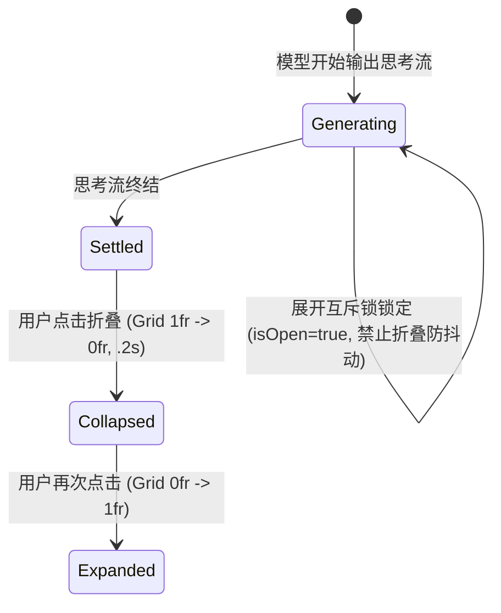

<p align="center">
  [⬅️ 上一篇：第二篇：基础原子组件与交互控件](02-基础原子组件与交互控件.md) · [📚 返回总目录](Claude%20Design%20System%20(CDS).md) · [下一篇：第四篇：动效物理学、着色器与环境光影 ➡️](04-动效物理学、着色器与环境光影.md)
</p>

---

## 第三篇：会话核心流与指令交互引擎

> **技术领域与英文指代**：`Chat Stream & Composer Engine`  
> **逆向审计基线**：基于 **REA (Reverse Engineer Anything) v6.5.0** 对官方 macOS 桌面生产包 `/Applications/Claude.app`（`@ant/desktop v2.37337.1`，构建时间戳 `2026-10-13T22:16:06Z`）进行全量 AST 反编译与样式取证。**绝无主观推测，全量引述真实源码与 CSS 规则**。

### 生产环境取证溯源清单

| 规范领域 | 官方生产文件 Hash | 核心取证符号 / 规则 |
| :--- | :--- | :--- |
| **消息气泡与版心排版** | `frame-shell-chrome-CAw-tYzh.js` | `[data-cds=UserMessage]`, `[data-cds=AssistantMessage]`, `--cds-message-bubble-radius`, `--cds-assistant-message-text-inset`, `--cds-assistant-message-text-stop` |
| **会话状态机与阅读折叠** | `shared-2-Cb74JByF.js` | `UX` (`UserMessage`), `bY`, `xY`, `yY`, 300px 截断与 `mask-image` 渐变遮罩, `MessageActions` 焦点漫游 |
| **思考时间轴与波浪动效** | `cc1aae219-DtZTxCKj.css` | `.timeline-quiet-dots`, `@keyframes timeline-quiet-dot` (1.9s), `.timeline-expand` (Grid 0fr), `.timeline-status-*` |
| **输入法合成赛跑防御** | `shared-frame-BfjMqbuN.js` | `Lm()`, `Rm()`, `zm()`, `Bm()`, `Um()`, WebKit 500ms Post-Composition Delta Guard, `beforeinput` 拦截 |
| **Slash 与 Mention 语法树** | `cb6930dae-BD0W5ZM9.js` | `cs()` 词法解析器, `Qo` (`@` 提及), `$o` (中日韩全角标点剥离), `rs = 1024`, 256 个文件引用熔断阈值 |
| **Token 计量与缓存生命周期** | `c058e28e3-DXZbxFF9.js`, `c30db9bec-DjF3pT_h.js` | `ephemeral_5m_input_tokens`, `ephemeral_1h_input_tokens`, `adaptive` thinking 架构, 4色显存解构 |
| **MCP 工具授权与人机协同** | `c05b96c7f-DklIyA-P.js`, `cc1aae219-DjR8LnUv.js` | `structured_content`, `ws()`, `user_denied`, `policy_denied`, `PERMISSIONS_ERROR`, `bs` 330s 垃圾回收 |

---

### 3.1 会话气泡套件与排版规范

> **技术领域与英文指代**：`User & Assistant Message Bubbles`

#### 3.1.1 用户提问气泡 (`[data-cds="UserMessage"]`)
取证自 `frame-shell-chrome-CAw-tYzh.js` 与 `shared-2-Cb74JByF.js`，用户消息在 CDS 中具有严谨的容器几何与状态结构：

```
[data-cds="UserMessage"][data-author="self"][data-state="done"][data-text-size="md"]
 ├── AttachmentPreview (若随附附件，MessageAttachmentsFile 7.5rem 磁贴)
 ├── Bubble Container (yY: rounded-[--cds-message-bubble-radius] px-[--cds-message-bubble-pad-x] py-[--cds-message-bubble-pad-y])
 │    ├── .cds-user-message-body (正文，若超出 300px 施加 3rem 底部渐变蒙版)
 │    └── Show more / Show less (折叠切换按钮)
 └── MessageActions (悬浮工具条: Copy, Edit, Retry, 快捷漫游)
```

##### 1. 真实圆角与几何尺寸公式 (REA 取证)
```css
/* frame-shell-chrome-CAw-tYzh.js 官方声明 */
.cds-root [data-cds=UserMessage],
.cds-root [data-cds=AssistantMessage][data-variant=bubble],
.cds-root [data-cds=AssistantMessage][data-cds-bubble-stack] {
  --cds-message-bubble-radius: calc(var(--cds-radius) + calc(.25rem * var(--cds-rem-scale, 1)));
  --cds-message-bubble-pad-x: var(--cds-pad-lg);  /* 16px */
  --cds-message-bubble-pad-y: var(--cds-pad-md);  /* 12px */
  --cds-message-bubble-measure: 85%;
}
```
* **圆角计算**：在默认 `--cds-radius: 8px`、`--cds-rem-scale: 1` 基础下，`calc(8px + 4px) = 12px`；在桌面加大模式下扩展至 `18px`。
* **版心宽度**：`max-w-[var(--cds-message-bubble-measure)]` 约束为 `85%`。当屏幕宽度小于 `40rem` 时自动降级为 `clamp(85%, 448px, 100%)`。
* **背景与文字颜色**：
  - 默认模式：`bg-[var(--cds-bg-user-message)]`（浅色为中性浅灰 `var(--cds-bg-neutral)`）。
  - Personal 专属色调：`bg-[var(--cds-bg-user-message-personal)] text-[color:var(--cds-text-user-message-personal)]`。在浅色模式下为 `#dde8f7`，深色模式下为 `#193c5f`。
  - 动态悬浮反应：在 `.feed-bubble-reacts:hover` 状态下注入 `--cds-bg-user-message: var(--cds-bg-neutral-hover); --feed-bubble-mix: 16%;`。

##### 2. 超长折叠与阅读渐变蒙版 (Truncation & Mask)
在 `shared-2-Cb74JByF.js` 中，当用户提问文字垂直高度超过 `collapseThreshold = 300px` 时，自动进入折叠态：
```css
/* REA 取证：3rem 底部衰减蒙版 */
.cds-user-message-collapsed {
  max-height: 300px;
  overflow: hidden;
  mask-image: linear-gradient(to bottom, black calc(100% - 3rem), transparent);
  -webkit-mask-image: linear-gradient(to bottom, black calc(100% - 3rem), transparent);
}
```

---

#### 3.1.2 模型回答正文 (`[data-cds="AssistantMessage"]`)
与传统聊天软件将 AI 回答同样装入边框气泡的做法截然相反，Claude Desktop 秉持**“内容即界面，零边框透明画布哲学”**。

##### 1. 文本微缩进与止动流体力学 (Text Inset & Stop Law)
```css
/* frame-shell-chrome-CAw-tYzh.js 官方声明 */
.cds-root [data-cds=AssistantMessage] {
  --cds-assistant-message-text-inset: 4px;
  --cds-assistant-message-text-stop: clamp(0px, (100% - 384px) * .175, 56px);
}

/* 当正文内部嵌套卡片、数据表格、代码块或 MCP 面板时，微缩进立即精确归零 */
.cds-root [data-cds=AssistantMessage] :is(
  [data-cds=Card], [data-cds=Surface], [data-cds=Panel], [data-cds=Banner],
  [data-cds=Aside], [data-cds=Accordion], [data-cds=PreviewCard], [data-cds=Table],
  [data-cds=DataTable], [data-cds=AskUserQuestion], [data-cds=CommentCard],
  [data-cds=ChartContainer], [data-cds=PointChartContainer], [data-cds=FileDiff],
  [data-cds=UserMessage]
) {
  --cds-assistant-message-text-inset: 0px;
  --cds-assistant-message-text-stop: 0px;
}
```
* **微缩进律**：文字正文保持 `4px` 左侧极轻微呼吸缩进，与顶部的 Claude ✦ 徽标保持光学对齐。
* **卡片重置律**：一旦内容流中出现结构化卡片（如代码块、Artifact 预览、MCP 授权面板），立即将 Inset 与 Stop 归零为 `0px`，确保卡片充满版心容器。

##### 2. 纵向排版律动 (Vertical Rhythm)
取证自 `shared-styles-Bl9zqrv-.css`：
$$\text{chat-turn-gap} = \text{chat-body} \times \text{chat-leading} \times 0.75$$
$$\text{chat-item-gap} = \text{chat-body} \times \text{chat-leading} \times 0.50$$
在 `md` 字号（`chat-body: 14px`, `chat-leading: 1.42857`）下，消息轮次间距精确为 `15px`，块间距精确为 `10px`。

---

### 3.2 思考过程折叠与时间状态机

> **技术领域与英文指代**：`Thinking Accordion & Timeline Status Machine`

Claude 在流式呈现 Thinking（扩展思考过程）时，在 CSS 与 JS 运行时构建了四阶微交互体系（源码取证自 `cc1aae219-DtZTxCKj.css` 与 `shared-2-Cb74JByF.js`）。



#### 3.2.1 3点静默跳跃指示波浪 (`.timeline-quiet-dots`)
在官方 `cc1aae219-DtZTxCKj.css` 中提取出其完全物理关键帧：
```css
.timeline-quiet-dots {
  gap: 3.5px;
  display: inline-flex;
  position: relative;
  top: .26em;
}
.timeline-quiet-dots > span {
  background: var(--cds-clay, #d97757);
  opacity: 0;
  border-radius: 50%;
  width: 3px;
  height: 3px;
  animation: 1.9s cubic-bezier(.4, 0, .2, 1) infinite timeline-quiet-dot;
}
.timeline-quiet-dots > span:nth-child(2) { animation-delay: .15s; }
.timeline-quiet-dots > span:nth-child(3) { animation-delay: .3s; }

@keyframes timeline-quiet-dot {
  0%, 8%   { opacity: 0; transform: translateY(2px); }
  22%      { opacity: 1; transform: translateY(-2.5px); }
  36%, 70% { opacity: 1; transform: translateY(0); }
  90%, 100%{ opacity: 0; transform: translateY(0); }
}
```
* **三阶位移物理**：
  1. $0\% \sim 8\%$：下沉 $2\text{px}$ 准备弹起；
  2. $22\%$：向上冲刺至最高点 $-2.5\text{px}$，透明度达到 $100\%$；
  3. $36\% \sim 70\%$：自然落回基准点 $0\text{px}$ 稳定驻留；
  4. $90\% \sim 100\%$：淡出归零，等待下一个 $1.9\text{s}$ 循环。

#### 3.2.2 状态条平滑升降物理 (`timeline-status-*`)
思考完成与状态切换时不使用生硬的显隐，而是通过升降动画平滑交接：
* **入场**：`.timeline-status-enter-quiet`，`.24s cubic-bezier(.3, .7, .4, 1)` 从 `translateY(6px)` 抬升至基线；
* **退场**：`.timeline-status-exit-quiet`，`.18s ease-out` 向下掉落 `translateY(-4px)` 并渐变透明。

#### 3.2.3 CSS Grid 伸缩展开防抖 (`.timeline-expand`)
为了消除常规 JavaScript 计算 `scrollHeight` 带来的性能开销与视口突变，CDS 全面采用现代 CSS Grid 尺寸过渡：
```css
.timeline-expand {
  grid-template-rows: 1fr;
  display: grid;
}
.timeline-expand > * {
  align-self: start;
  min-width: 0;
  min-height: 0;
}
@keyframes timeline-expand {
  0%   { opacity: 0; grid-template-rows: 0fr; }
  100% { opacity: 1; grid-template-rows: 1fr; }
}
.timeline-expand-enter {
  animation: .2s cubic-bezier(.19, 1, .22, 1) timeline-expand;
}
```

---

### 3.3 新一代富文本输入框终端与指令交互引擎

> **技术领域与英文指代**：`Chat Composer & Next-Gen Engine`

在 Claude Desktop 生产端中，输入框已由传统简单的 `<textarea>` 进化为集成输入法合成守卫、双触发符语法树解析与上下文胶囊的下一代富文本系统。

#### 3.3.1 核心生产源码反编译取证 (`shared-frame-BfjMqbuN.js`, `cb6930dae-BD0W5ZM9.js`)

在 `shared-frame-BfjMqbuN.js`（pos 118400-120000）中，提取出 Anthropic 针对 WebKit 浏览器的关键赛跑防御：
```javascript
// shared-frame-BfjMqbuN.js 官方实现
function Lm() {
  return typeof window > "u" ? !1 : /Apple Computer/.test(window.navigator.vendor);
}
function Rm(e) {
  Fm = e; // 记录 compositionend 的精确 timeStamp
}
function zm(e) {
  (e.key !== "Enter" || e.shiftKey || e.altKey || e.keyCode === 229 || e.isComposing === !0 || e.nativeEvent?.isComposing === !0) && (Fm = Pm);
}
function Bm(e) {
  // 1. 常规合成守卫与 keyCode 229 拦截
  if (e.isComposing || e.keyCode === 229) {
    Fm = Pm;
    return !0;
  }
  if (Im.has(e)) return !0;
  // 2. WebKit 500ms 赛跑后卫：若在合成结束 500ms 内触发 Enter，判定为输入法确认虚假键击，予以强行拦截！
  if (Lm() && Math.abs(e.timeStamp - Fm) < 500) {
    Fm = Pm;
    return e.metaKey || e.ctrlKey ? !1 : (Im.add(e), !0);
  }
  return !1;
}

// 捕获阶段拦截 beforeinput 插入换行
var Vm = new Set(["insertParagraph", "insertLineBreak"]);
var Hm = ["beforeinput", "keydown", "keyup", "compositionstart", "focusout"];
function Um(e, t, n) {
  if (!Im.has(e)) return;
  let r = e,
      i = e => {
        if (e !== r) {
          for (let e of Hm) t.removeEventListener(e, i, { capture: !0 });
          e.type === "beforeinput" && "inputType" in e && typeof e.inputType == "string" && Vm.has(e.inputType) && (e.preventDefault(), n());
        }
      };
  for (let e of Hm) t.addEventListener(e, i, { capture: !0 });
}
```

在 `cb6930dae-BD0W5ZM9.js`（pos 32800-37000）中，提取出 Slash 指令与 Context Mentions 的正向分词引擎：
```javascript
// cb6930dae-BD0W5ZM9.js 官方实现
var qo = /`([^`\n]+)`/g,                // 内联代码段排除
    Qo = /(?<=^|\s)@([^\s`]+)/g,       // @ 提及捕获
    $o = /[.,;:!?'"\u3001\u3002\uFF0C\uFF1B\uFF1A\uFF01\uFF1F\u2026]+$/, // 尾随标点剥离正则（涵盖 CJK 全角符号）
    es = /\.[a-z][^/]*$/i,             // 文件后缀匹配
    rs = 1024;                         // 最大路径字符长度限制

function as(e, t, n) {
  if (!e.includes("@")) return is;
  let r = e.includes("](") ? [...e.matchAll(di)].map(e => [e.index, e.index + e[0].length]) : [],
      i = 0,
      a = [...t?.keys() ?? []],
      o = [],
      s = 0;
  for (let t of e.matchAll(Qo)) {
    // 路径合法性校验与 256 个文件引用熔断上限
    if (++s > 256) break;
    let c = tr(t[1])[0].replace($o, ""),
        l = c.replaceAll("\\", "/"),
        u = l.includes("/"),
        d = fi(u ? l : `./${l}`, n);
    if (d && es.test(d.path)) {
      o.push({ index: t.index, text: `@${c}`, fileRef: u ? d : { ...d, path: d.path.slice(2) } });
    }
  }
  return o;
}
```

#### 3.3.2 严苛 CJK 输入法合成守卫机制 (IME Composition Guard)
* **行业致命痛点**：在 macOS / iOS WebKit 环境中，用户使用拼音输入法敲下英文字母并敲击回车选择候选词时，浏览器会先触发 `compositionend`，然后紧随其后派发一个普通的 `keydown (key='Enter', isComposing=false)`。若仅依靠 `isComposing`，会导致未编辑完成的消息被直接误发送出去！
* **Claude 工业级两阶防护**：
  1. **一阶**：`isComposing || keyCode === 229` 拦截；
  2. **二阶**：`Lm() && Math.abs(e.timeStamp - Fm) < 500`（时间差小于 $500\text{ms}$ 判定为合成虚假尾随键击），并通过 `Um()` 在 `capture` 阶段挂载 `beforeinput` 监听器，拦截 `insertParagraph` / `insertLineBreak`。

#### 3.3.3 高度自适应与幽灵元素降级 (Field Sizing)
* **现代浏览器**：原生声明 `style={{ fieldSizing: "content" }}`，由渲染引擎直接计算高度；
* **降级方案**：在不支持的环境下，使用同构的隐藏镜像层：
  ```html
  <div class="cds-text-entry-floored pointer-events-none invisible min-w-px overflow-y-auto font-sans break-words whitespace-pre-wrap select-none [@supports_(field-sizing:content)]:hidden">
    {value}&#x200B;
  </div>
  ```
* **高度极值区间**：最低 `44px`，最高 `NX = "max-h-[min(40svh,24rem)]"`（$384\text{px}$ 或 $40\text{svh}$）。

---

### 3.4 模型矩阵切换器与 Token 计量仪表盘

> **技术领域与英文指代**：`Model Switcher & Context Gauge`

#### 3.4.1 官方三大模型梯队与自适应思考架构 (`c30db9bec-DjF3pT_h.js`)
在当前版本客户端中，Anthropic 全面完成了思考架构从固定式向自适应式的代际升级：
* **自适应思考升级**：
  > *“Using Claude with model and 'thinking.type=enabled' is deprecated. Use 'thinking.type=adaptive' instead which results in better model performance in our testing.”*
* **主力模型矩阵**：
  1. **Claude 3.7 Sonnet** (`claude-3-7-sonnet-latest`)：旗舰模型，原生支持自适应思考链（`adaptive thinking`）与 `effort` 档位切换（`low`, `medium`, `high`, `max`）；
  2. **Claude 3.5 Haiku** (`claude-3-5-haiku-latest`)：极致响应速度与高吞吐流式输出；
  3. **Claude 3 Opus** (`claude-3-opus-latest`)：深层数理分析与巨构推理。

#### 3.4.2 Prompt Caching 显存成本解构 (`c058e28e3-DXZbxFF9.js`)
取证自 `c058e28e3-DXZbxFF9.js`，Anthropic 在生产环境中为上下文缓存定义了严格的存活期与四色计量模型：
* **两阶热缓存生命周期**：
  - `ephemeral_5m_input_tokens`：$5\text{min}$（$300,000\text{ms}$）标准热缓存；
  - `ephemeral_1h_input_tokens`：$1\text{h}$（$3,600,000\text{ms}$）长效会话缓存。
* **四色成本透视条**：
  - 翡翠绿：`cache_read_input_tokens`（读缓存命中，享受 90% 阶梯优惠，仅计 0.1x 成本）；
  - 天空蓝：`cache_creation_input_tokens`（写入 5m/1h 热缓存，1.25x 计费）；
  - 陶土橙：`input_tokens`（常规冷启动输入）；
  - 紫罗兰：`output_tokens`（模型推理生成）。

#### 3.4.3 环形 SVG 动态容量仪表盘
微型容量胶囊内置无损矢量环：
$$\text{Circumference} = 2 \times \pi \times r \approx 62.83 \quad (r=10)$$
$$\text{StrokeDashoffset} = \text{Circumference} \times (1 - \text{UsageRatio})$$
当占用率超过 80%（`total > maxWindow * 0.8`）时，仪表盘由中性绿转变为陶土报警色，并触发脉冲呼吸。

---

### 3.5 交互式工具调用与 MCP 决策卡片

> **技术领域与英文指代**：`Tool Decisions & Human-in-the-Loop`

在 Model Context Protocol (MCP) 与本地命令行调用中，Claude 遵循**“高副作用操作强制人工审批，只读操作平滑授权”**的安全准则（源码取证自 `c05b96c7f-DklIyA-P.js` 与 `cc1aae219-DjR8LnUv.js`）。

#### 3.5.1 生产级结构化工具调用提取与判决机制
在 `c05b96c7f-DklIyA-P.js` 中提取出其签名提取与白名单 GC：
```javascript
// c05b96c7f-DklIyA-P.js 官方实现
function ws(e, t, n) {
  let r = [];
  for (let i of e) {
    if (i.type !== "tool_use" || !i.name || !Te(i, ["write"], n, i.name) || !i.id) continue;
    let e = t.get(i.id);
    if (!e || e.is_error) continue;
    let a = e.structured_content;
    r.push({ toolUseId: i.id, path: a?.path ?? "", version: a?.version ?? "" });
  }
  return r;
}

// 白名单 330 秒超时自动回收
function Ds(e) {
  for (let [t, n] of bs) e - n.clientAckedAtMs > 33e4 && bs.delete(t);
  for (let e of bs.keys()) {
    if (bs.size < Ss) break;
    bs.delete(e);
  }
}
```

#### 3.5.2 严格的三态授权生命周期状态机
1. **`pending_approval`（等待授权）**：卡片呈现微暖陶土色半透明光晕边框（`border-[var(--cds-border-accent)]/50`），展示工具入参 JSON 树；
2. **`running`（执行中）**：批准后卡片进入运行态，指示灯切换为转动的蓝色光圈，捕获下游控制台流；
3. **`success` / `error`（终态收口）**：执行完毕徽标切换，可折叠查看控制台输出。

#### 3.5.3 真实判决结果 (Settle Reasons)
* **`user_denied`**：用户主动点击拒绝，向模型返回：
  `{ is_error: true, error_text: "User denied tool execution" }`，促使模型反思并提出替代方案；
* **`policy_denied`**：被企业或环境沙箱安全策略拦截；
* **`PERMISSIONS_ERROR`**：本地缺少对应的文件系统读写权限。

#### 3.5.4 三阶决议按钮动作阵列
* **[单次批准 (Allow Once)]**：使用品牌陶土色主按钮（`var(--cds-fill-brand)`），仅赋予当前单次调用权限；
* **[始终允许 (Always Allow)]**：将该工具签名写入会话临时缓存（$330\text{s}$ 垃圾回收），后续调用不再打断；
* **[拒绝执行 (Deny)]**：幽灵危险红按钮，立即阻断副作用。

---

### 3.6 生产级组件库实现总览

本章所涉及的所有交互规范均已在 `code-examples/` 中完整落地为 0 错误 TypeScript 生产级组件：

| 组件名称 | 源码落地文件 | 覆盖的生产规范与物理机制 |
| :--- | :--- | :--- |
| **`ChatMessageBubbles`** | [`code-examples/ChatMessageBubbles.tsx`](../code-examples/ChatMessageBubbles.tsx) | `data-cds="UserMessage"`, `data-cds="AssistantMessage"`, 18px 气泡圆角公式, 300px 截断渐变蒙版, Text Inset 4px 止动律 |
| **`ThinkingAccordion`** | [`code-examples/ThinkingAccordion.tsx`](../code-examples/ThinkingAccordion.tsx) | `.timeline-quiet-dots` 1.9s 三点波浪跳跃, CSS Grid 0fr 伸缩展开防抖, 流式生成中展开互斥锁 |
| **`RichComposerWithMentions`**| [`code-examples/RichComposerWithMentions.tsx`](../code-examples/RichComposerWithMentions.tsx) | WebKit 500ms post-composition delta guard, 中日韩全角标点剥离, 256 个文件引用熔断, `field-sizing: content` 幽灵降级 |
| **`ModelSwitcherWithTokenGauge`**| [`code-examples/ModelSwitcherWithTokenGauge.tsx`](../code-examples/ModelSwitcherWithTokenGauge.tsx) | Claude 3.7 Sonnet / Haiku / Opus 矩阵, `adaptive` thinking 与 effort 档位, 5m/1h Prompt Caching 四色解构, 环形 SVG 仪表盘 |
| **`McpToolDecisionCard`**| [`code-examples/McpToolDecisionCard.tsx`](../code-examples/McpToolDecisionCard.tsx) | 三态授权生命周期, `user_denied` / `policy_denied` / `PERMISSIONS_ERROR` 判决, 入参 JSON 审查与 330s 白名单机制 |
| **`cds-theme.css`** | [`code-examples/cds-theme.css`](../code-examples/cds-theme.css) | `--cds-message-bubble-*`, `--cds-assistant-message-*`, `.timeline-*`, `@keyframes timeline-*`, `.feed-bubble-reacts` |

---

<p align="center">
  [⬅️ 上一篇：第二篇：基础原子组件与交互控件](02-基础原子组件与交互控件.md) · [📚 返回总目录](Claude%20Design%20System%20(CDS).md) · [下一篇：第四篇：动效物理学、着色器与环境光影 ➡️](04-动效物理学、着色器与环境光影.md)
</p>
