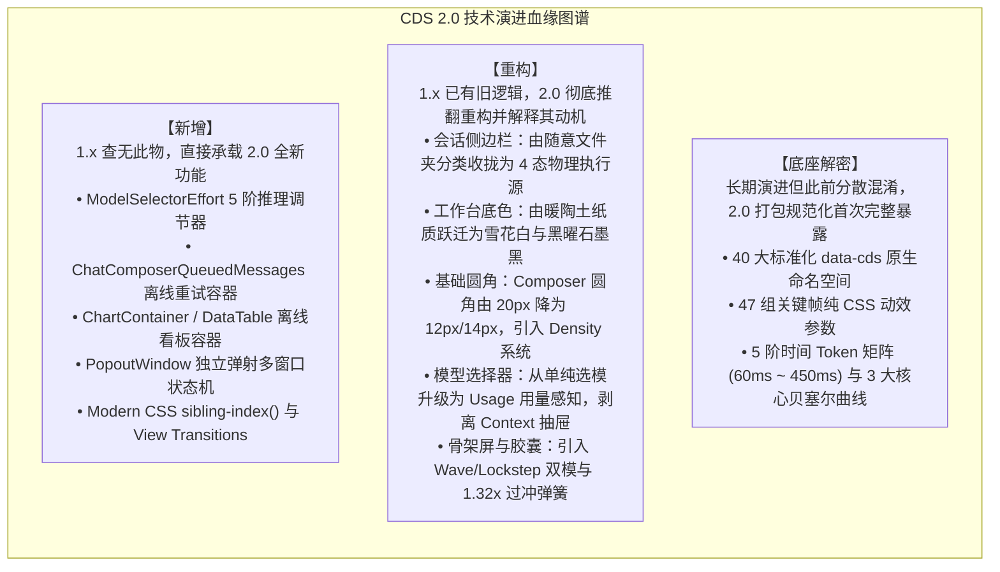

# 第一章：综述与版本边界

## 1. 综述

### 1.1 版本边界声明

在本次 2026-10-15 发布的 Claude 桌面端全量更新中，软件版本跃升至 **v2.37337.1**（`@ant/desktop@2.37337.1`）。

依托 REA 对该版本解包出的 `MainWindowPage-BD9CWQ83.css`、`index.chunk-BWk6pVUt.js` 以及核心 Vite 模块的审查，我们确立了本篇报告的核心技术特征分类准则：

同时，我们明确划分桌面端包与命令行独立发布的边界：
* **桌面端捆绑版本**：本次桌面端 v2.37337.1 内部捆绑的 Claude Code CLI 为 **2.1.295**；
* **同日独立发布版本**：CLI 2.1.299 / 2.1.300（包含 idle compaction、`/effort` 命令、mod virtualText）属于独立的命令行更新，不包含在桌面端安装包内。

---

### 1.2 全局设计契约演进

#### 1. 1.x 对话外壳 vs 2.0 执行沙箱工作站对比

| 核心维度 | CDS 1.x 规范基线 | CDS 2.0 架构升级 |
| :--- | :--- | :--- |
| **应用定位** | 单一窗口的“大模型流式对话外壳” | 具备本地 VM 隔离与多智能体分发的“开发工作站” |
| **执行载体隔离** | 模糊的本地文件夹绑定 | 严格区分 **本机 (This Computer) / Cloud / SSH / Slack** 四大物理执行源 |
| **多任务视图** | 单一主窗口，聊天与文件分屏挤压 | 支持独立的 **`PopoutWindow`（弹射窗口）**，多屏幕并行查看 |
| **离线自治能力** | 严重依赖公网 CDN 拉取渲染脚本 | **本地 ASAR 内置三大渲染引擎**，断网强可用 |
| **状态持久化** | 仅依赖内存状态，刷新即丢失未决输入 | **IndexedDB 离线重试账本**，刷新原位恢复 |

#### 2. 为什么 Anthropic 要重塑全局契约

1. **从“聊天机器人 (Chatbot)”向“自主智能体 (Autonomous Agent)”的范式转移**：  
   在 1.x 时代，用户与 Claude 的交互以文本交谈、代码生成并手动复制为主。到了 2.0 时代，Claude Code CLI 与 Cowork 模式开始接管用户计算机的终端操作、文件自动读写与并行 Git 分支克隆。如果继续沿用旧有的“单窗口会话”模式，后台运行的自主任务会极易打断用户前台操作（例如吃键盘输入、抢焦点）。
2. **物理安全与沙箱权限的严格收敛**：  
   旧版本按文件夹分类让用户误以为所有任务的执行边界是一样的。实际上，运行在本地轻量级 Linux 虚拟机、远端 Linux SSH 服务器与云端容器的任务，其破坏性、文件写入范围与安全边界完全不同。因此，2.0 强制将会话重构为按**物理源（Environment）**隔离，消除安全越界风险。

#### 3. 核心设计契约：环境不可变性与零丢失输入承诺

* **契约 1：环境在会话创建后不可变（Environment Immutability）**：  
  在 2.0 中，会话一旦由 `NewSessionDrawer` 创建，其绑定的上下文窗口大小（Context Window）、Worktree 根目录及 MCP 扩展配置即刻被永久冻结，杜绝在长对话中途因修改环境导致的 Prompt Caching 失效与状态错乱。
* **契约 2：用户指令零丢失保证（Zero-loss Input Promise）**：  
  不论是应用意外崩溃、网络瞬间闪断、触发 5 小时速率限制还是开发者主动刷新窗口，用户输入的工程指令必须被持久化在本地存储中，并具备确定性的原位重试机制。

---
